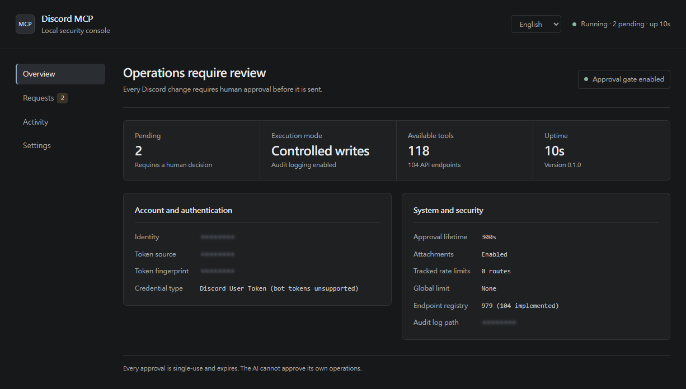
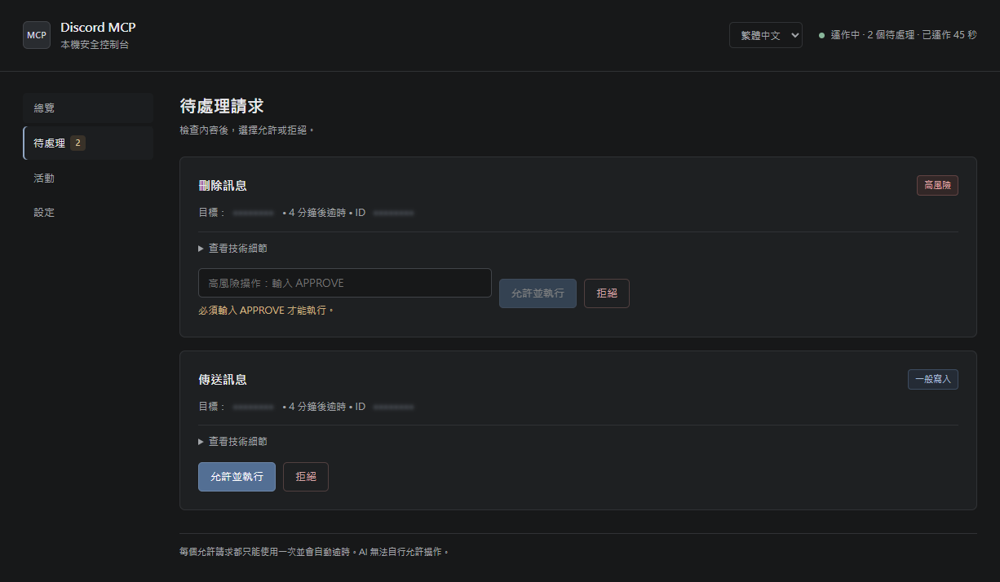
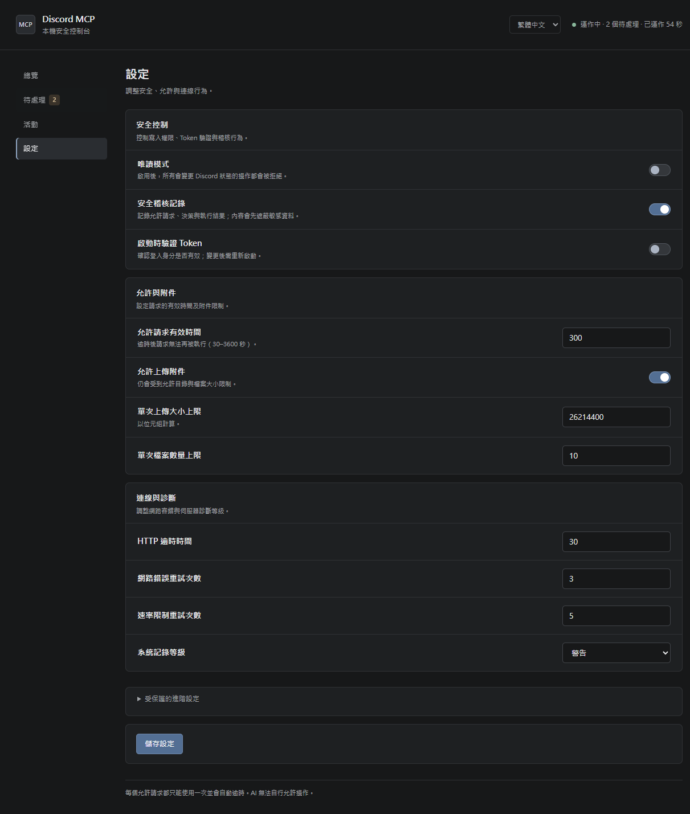

# discord-user-mcp

An MCP server that exposes the **Discord user API** to an AI agent, with a hard,
server-side **human approval gate** in front of every state-changing operation.

It is a Python 3.12 project built on FastMCP (MCP SDK), httpx and Pydantic. It
speaks HTTP only: no gateway, no voice, no bot account.

> **Read this first.** Automating a normal Discord account (a "self-bot") violates
> Discord's Terms of Service and can get the account banned. Use this only on an
> account you are willing to lose, never against other people's servers, and never
> to evade rate limits, captchas or other platform controls. This project does not
> bypass any of them; when Discord blocks a request it reports the block.

---

## Why an approval gate

An MCP client cannot be trusted to be the last line of defence: the model can be
talked into anything, and many clients have no confirmation UI at all. So the gate
lives **inside the server process**, not in the client and not in the prompt.

```
agent calls send_message
        |
        v
dispatch() --- risk=read? --- yes --> HTTP request --> result
        |
        no
        v
create pending approval (SQLite)  <-- no HTTP request is made
        |
        v
return {status: "approval_required", approval_id, arguments, args_hash}

     ... a human opens the local console ...

approve(id) -- single-use SQL transition --> re-hash stored args --> execute
        |
        v
agent calls check_approval(id) --> completed / failed / denied / expired
```

Properties this design gives you:

| Property | How |
|---|---|
| The AI cannot approve its own call | There is no MCP tool that approves. `cancel_approval` can only cancel. |
| No request before approval | A mutating tool only writes a pending row; the HTTP client is not touched. |
| Approval is for the exact call | Arguments are stored and hashed; execution uses the stored arguments. |
| No parameter swapping | The digest is recomputed before execution; a mismatch fails the row. |
| No replay | `UPDATE ... WHERE status='pending'` makes decisions single-shot; the executor claims `approved -> executing` atomically. |
| No stale approvals | Pending rows expire (default 5 min) and expiry is enforced again at execution. |
| High-risk needs more than a click | `admin`, `destructive` and `sensitive` require the operator to type `APPROVE`. |
| A restart cannot resurrect work | On startup, `approved`/`executing` rows are marked `failed`. |
| The console is local | It binds to loopback, requires a random per-process token, sends no CORS headers and rate-limits failed attempts. |
| No token leak | The token is a `SecretStr`, never logged, redacted from every audit entry, and the console token is never exposed to MCP. |
| Auditable | JSONL audit log of requests, decisions and executions, with redaction. |
| Read-only switch | `DISCORD_MCP_READ_ONLY=1` disables every mutating tool. |

Threat model, honestly: this protects against a misled or over-eager agent and
against a client that silently auto-approves. It does not protect against malware
already running as your user, someone who can read your environment variables, or
someone who can read `approval-console.json`. Run it on a machine you control.

---

## Requirements

- Python **3.12+** (the repository is developed against the Windows embeddable
  build, see below)
- `mcp`, `httpx`, `pydantic`; `pytest` + `pytest-asyncio` for the tests
- A Discord **user** token. Bot tokens are explicitly unsupported.

## Install

Standard install:

```bash
pip install -e .
python -m discord_user_mcp --check     # validate config + token
python -m discord_user_mcp            # start the MCP server on stdio
```

Windows embeddable Python (what this repo was built with, no installer needed):

```powershell
# 1. Download the official zip and verify it
Invoke-WebRequest https://www.python.org/ftp/python/3.12.10/python-3.12.10-embed-amd64.zip -OutFile py312.zip
Get-FileHash py312.zip -Algorithm SHA256
# 4ACBED6DD1C744B0376E3B1CF57CE906F9DC9E95E68824584C8099A63025A3C3

Expand-Archive py312.zip -DestinationPath .python-embed
# .python-embed/python312._pth must contain, in order:
#   python312.zip
#   .
#   Lib\site-packages
#   ..\src
#   import site

uv pip install --python-version 3.12 --target .python-embed\Lib\site-packages `
  "mcp>=1.9,<2" "httpx>=0.27,<1" "pydantic>=2.7,<3" "pytest>=8.2" "pytest-asyncio>=0.23"

.\.python-embed\python.exe -m pytest
.\.python-embed\python.exe -m discord_user_mcp --check
```

## Configure

Copy `.env.example` to `.env` (or export the variables) and set
`DISCORD_USER_TOKEN`. `.env` is read from the working directory at startup;
real environment variables take precedence, and `DISCORD_MCP_ENV_FILE=0`
turns the file off. The most important knobs:

| Variable | Default | Meaning |
|---|---|---|
| `DISCORD_USER_TOKEN` / `DISCORD_USER_TOKEN_FILE` | unset | The user token. A `Bot ` prefix is rejected. |
| `DISCORD_MCP_STATE_DIR` | `%LOCALAPPDATA%\discord-user-mcp` | Approvals DB, audit log, dashboard token/settings, default uploads. |
| `DISCORD_MCP_APPROVAL_TTL` | `300` | Seconds a pending approval stays valid (30-3600). |
| `DISCORD_MCP_CONSOLE_ENABLED` | `1` | If `0`, every mutating tool refuses to run. |
| `DISCORD_MCP_CONSOLE_HOST` / `_PORT` | `127.0.0.1` / `0` | Loopback only; a non-loopback host is rejected. |
| `DISCORD_MCP_READ_ONLY` | `0` | `1` disables all writes. |
| `DISCORD_MCP_UPLOAD_ROOTS` | `<state>/uploads` | Allow-list for attachment paths (`os.pathsep` separated). |
| `DISCORD_MCP_MAX_UPLOAD_BYTES` | `26214400` | Per-file and total attachment cap. |
| `DISCORD_MCP_API_BASE` | `https://discord.com/api/v9` | Point at a stub for tests. |
| `DISCORD_MCP_AUDIT` | `1` | JSONL audit log on/off. |
| `DISCORD_MCP_ENV_FILE` | `.env` | dotenv path read at startup; `0` disables it. |

Settings changed in the dashboard are stored in
`<state>/dashboard-settings.json` (0600) and reloaded at startup. They override
the matching `.env` defaults, with one exception: `DISCORD_MCP_READ_ONLY=1` is a
hard lock that the dashboard cannot undo.

## Register with an MCP client

Most clients take a command plus its environment. Example:

```json
{
  "mcpServers": {
    "discord-user": {
      "command": "C:\\path\\to\\DiscordMCP\\.python-embed\\python.exe",
      "args": ["-m", "discord_user_mcp"],
      "env": {
        "PYTHONPATH": "C:\\path\\to\\DiscordMCP\\src",
        "DISCORD_USER_TOKEN": "<your user token>",
        "DISCORD_MCP_STATE_DIR": "C:\\Users\\<you>\\AppData\\Local\\discord-user-mcp"
      }
    }
  }
}
```

At startup the server prints to **stderr**:

```
  discord-user-mcp 0.3.0 - Discord user API MCP server
  tools: 257   read-only: no   approval TTL: 300s
  token source: env:DISCORD_USER_TOKEN   fingerprint: sha256:1a2b3c4d5e6f
  credential type: Discord USER token (bot tokens are not supported)
  authenticated as: yourname (123456789012345678)

  LOCAL DASHBOARD (status, approvals, activity and settings):
    http://127.0.0.1:54321/?t=<random token>
    token file: C:\Users\you\AppData\Local\discord-user-mcp\approval-console.json (keep private)
```

stdout is reserved for the MCP protocol. If your MCP client hides stderr, the
token file path above is the reliable place to look.

### Where the dashboard token lives

The file is always `<state_dir>/approval-console.json`. The default `state_dir`
is your OS's per-user local data folder, so on Windows it is normally:

```text
%LOCALAPPDATA%\discord-user-mcp\approval-console.json
```

`DISCORD_MCP_STATE_DIR` moves it. It is created when the dashboard starts,
contains the authenticated URL, the token and the server PID, and is written with
owner-only permissions. `DISCORD_MCP_CONSOLE_TOKEN_FILE=0` disables the file, in
which case the startup URL is the only copy.

You do not have to remember the path: the startup banner prints it, the locked
pages shows the file path, the **Overview** tab shows it under *Token file*, and
`get_server_status` returns it as `mode.approval_console.token_file`. Only the
path is shared with the agent; the file contents (the token) are not.

## The dashboard

The console URL printed at startup opens a local dashboard with four tabs:

| Tab | What it shows |
|---|---|
| Overview | account identity, token source/fingerprint, read-only state, approval TTL, tool and registry counts, rate limits, token file and audit path |
| Requests | pending operations; approve, deny, or type `APPROVE` for high-risk |
| Activity | approval outcomes plus the redacted JSONL security trail |
| Settings | the editable settings, with locked values shown read-only |

### Screenshots

English interface, captured with local test data. Sensitive values
remain hidden; no real Discord account or credential is shown.

**Overview — server status and security controls**



**Requests — human approval and typed confirmation for high-risk operations**



<details>
<summary>Settings — editable security, upload and connection options</summary>



</details>

### Access and privacy

It is served by the server on loopback and there are no CORS headers. Opening the
safe base address without a credential shows only a locked landing page; every
dashboard data/API request still requires the per-process dashboard token. The
token stays in the human's browser and is never exposed to an MCP tool. The page
refreshes every three seconds but updates countdowns in place, so a button never
detaches under your pointer.

### Dashboard address reported by the AI

`get_server_status` returns a safe address in
`mode.approval_console.dashboard_url`. Every `approval_required` response returns
a request-specific address in `console.dashboard_url`:

```text
http://127.0.0.1:<port>/?request=ap_<request-id>
```

The AI should give this address to the user automatically. It contains an
approval **request ID**, not the dashboard token, so knowing it cannot authorise
anything. Opening it shows the locked page; the human unlocks locally using the
authenticated startup link or token in `approval-console.json`. After unlocking,
the dashboard opens the Requests tab and highlights that approval.

The AI-facing handoff should look like this Markdown:

```markdown
### Waiting for approval

- **Operation:** Delete message
- **Target:** verified channel/message
- **Risk:** destructive
- **Approval ID:** `ap_...`
- **Dashboard:** <http://127.0.0.1:54321/?request=ap_...>
- **Token file:** `<state_dir>/approval-console.json` (path only; the AI does not read it)

Open the dashboard locally and unlock it using the server startup link or
`approval-console.json`. The dashboard access token is deliberately unavailable
to the AI.
```

Do not change request IDs into authentication credentials: the AI receives the
request ID itself, so using it to unlock approvals would let the AI approve its
own work.

The interface supports **Traditional Chinese and English**. It selects a
language from the browser on first use, provides a language menu in the header,
and remembers the choice in browser storage. Human-readable operation
names (for example, `Delete message` / `刪除訊息`) are used as headings. The
exact tool name (`delete_message`), endpoint, approval ID, risk, argument hash
and full JSON remain available under **Technical details**, preserving the
information needed to audit a decision.

Language changes update empty states, controls, log-level labels, hints and
errors in place, without clearing unsaved settings or typed confirmations. The
locked entry page uses the same saved language preference. Exact tool names,
JSON keys/payloads, IDs and confirmation phrases remain unchanged for auditing.

Potentially sensitive values are hidden by default: account identity, target and
approval IDs, token source/fingerprint, actors, local paths, console URL and
state-directory details. Each value must be clicked to reveal it. Full request
arguments and execution/audit payloads require a separate manual expansion.

Masking protects against accidental on-screen disclosure; it is not encryption
or a substitute for authentication. After unlocking, the browser removes `t`
from the address bar and keeps the credential in page memory. Reloading the safe
URL requires unlocking again.

Editable settings: read-only mode, log level, audit on/off, startup token
verification, approval lifetime, upload limits, and HTTP timeout/retry counts.

Locked settings (environment/`.env` only): the token, API base URL, console bind
address and state directory. Keeping them out of the page means a dashboard
request cannot redirect the credential or expose approvals on the network.

Turning read-only mode **off** requires typing `ENABLE WRITES`, and is refused
when `DISCORD_MCP_READ_ONLY=1` is set. Changes apply immediately, except
`require_startup_auth_check`, which the page reports as needing a restart.

## Approving an operation

1. The agent calls a mutating tool and gets `status: "approval_required"` with the
   full arguments, a risk label and an expiry.
2. Open the request-specific safe dashboard URL reported by the agent, unlock it
   locally, then approve, deny, or (for high-risk) type `APPROVE` first.
3. Approving schedules execution **inside the server**; the agent never sends the
   request itself.
4. The agent calls `check_approval(approval_id)` to collect the result. The status
   moves `pending -> approved -> executing -> completed | failed`, or to
   `denied` / `cancelled` / `expired`.

If the console is closed or disabled, nothing can be approved. That is deliberate.

## Agent skill and API routing

`skills/discord-user/SKILL.md` is the whole agent-facing skill — one file, so a
client never loads a router that points at a guide it did not fetch. It contains:

- the safety rules and approval handoff (including the safe Dashboard address);
- an intent router table for common requests;
- the complete **257-tool** catalog grouped by domain:
  - server, registry and approvals;
  - users, account, profile and settings;
  - guilds and channels, messages, search, pins and polls;
  - direct messages, members, moderation and roles;
  - threads, reactions, invites and scheduled events;
  - friends, relationships, assets, audit and application commands;
- short recipes, pagination rules and an error-code routing table.

Known intents go straight through the router; unfamiliar requests fall back to
`search_api_endpoints` and `get_api_endpoint`. The skill never invents a tool or
substitutes arbitrary HTTP.

## Tools

257 MCP tools: 152 read-only and 105 gated. By risk:

| Risk | Count | Gate |
|---|---|---|
| `read` | 152 | runs immediately |
| `write` | 35 | approval |
| `admin` | 34 | approval + typed `APPROVE` |
| `destructive` | 20 | approval + typed `APPROVE` |
| `sensitive` | 16 | approval + typed `APPROVE` |

Coverage includes guilds, members, roles, join requests, templates, widgets,
welcome screens, AutoMod, forum tags, public/private threads, messages, saved
messages, pins, polls, announcement crossposting, scheduled events, reactions,
relationships, DMs, invites, profiles, connections, notification snapshots,
integrations, emoji, stickers, soundboard metadata, stage metadata, application
discovery, guild discovery, games and activity statistics.

The 139 added tools use a fixed, reviewed catalog in
`src/discord_user_mcp/api/extended_tools.json`. Each gets an endpoint-specific,
typed MCP schema; callers cannot select a raw URL, method or arbitrary body.
Inputs are validated before approval and again at execution. Connection access
tokens, refresh tokens and client secrets are redacted from returned data.
Optional null/omitted update fields are not sent; these tools expose bounded
subsets rather than claiming every documented field is supported.

**Testing is mock-only:** a registered tool has a real HTTP implementation, but
live availability still depends on Discord permissions, account eligibility and
feature rollout. No live Discord account was used to verify these endpoints.

Every mutating tool accepts `dry_run=true`, which shows the exact method, path and
payload an approval would authorise without creating a request.

Local tools (no Discord traffic): `get_server_status`, `search_api_endpoints`,
`get_api_endpoint`, `list_approvals`, `check_approval`, `cancel_approval`,
`get_audit_log`, `get_rate_limit_status`.

### The endpoint registry

`src/discord_user_mcp/api/registry_data.json` contains **979 extracted registry
entries** from the community user-API documentation at
<https://docs.discord.food> (the `discord-userdoccers` MDX sources):

| Status | Count | Meaning |
|---|---|---|
| `implemented` | 243 | has one or more MCP tools |
| `documented` | 523 | documented endpoint, not exposed as a tool in this build |
| `unsupported` | 213 | deliberately excluded, including 5 formatting examples |

The registry is generated by `tools/build_registry.py` from
`research/endpoint-inventory.json`, `research/registry_overrides.json` and
`src/discord_user_mcp/api/extended_tools.json`. The
build **fails** if an override names an endpoint the documentation does not
contain. Extended tools also check every selected query/body field against the
documentation, and reject read-only classifications on mutating methods.
Tests enforce that
every tool maps to a declared endpoint, that no endpoint is claimed without a
tool, and that every tool's risk matches the curated classification.

Use `search_api_endpoints` / `get_api_endpoint` to ask the server what exists
before concluding something is impossible.

### Notable exclusions (with reasons in the registry)

Billing, payment sources, subscriptions, gifts and Nitro (money); MFA
enrolment/disable, phone/email verification, captcha and device login (security
flows that must stay human); account delete/disable; the gateway and realtime
events; voice (needs WebSocket + UDP/RTP); interactions; OAuth2
client-credentials; bulk delete (bot-only in practice); reports and Family
Center; quests and collectibles.

Because there is no gateway, this server is **request/response only**. It does
not receive message events, typing events or presence updates; the agent must
poll with read tools.

## HTTP behaviour

- `Authorization` carries the **raw user token**; the `Bot ` prefix is never used.
- `401` is never retried (the token is wrong); the error tells you to replace it.
- `429` is retried after Discord's `retry_after`, per bucket **and** globally, and
  the bucket is remembered so later calls wait instead of hammering.
- `5xx` is retried with exponential backoff and jitter.
- Network errors are retried only for idempotent methods. A failed `POST` is
  reported with a warning that it may already have been applied.
- Every tool accepts optional `response_max_bytes`: the model chooses a budget
  per call, bounded by the operator's ceiling. Oversized results retain a
  structural prefix and explicitly set `response.truncated=true`.
- Attachments may only be read from `DISCORD_MCP_UPLOAD_ROOTS`.

### Model-selected response size

The default is **4 MiB**; the absolute maximum is **16 MiB**. The model may
request any integer budget from **1024 to 16777216 bytes**, for example:

```json
{"channel_id":"123456789012345678","limit":100,"response_max_bytes":8388608}
```

The operator can lower the default and ceiling in the dashboard's network
settings or through `DISCORD_MCP_RESPONSE_DEFAULT_BYTES` and
`DISCORD_MCP_RESPONSE_MAX_BYTES`. The default must not exceed the ceiling.
Saved dashboard settings override environment values for these fields; older
dashboard files without these fields preserve the environment limits.
Model requests above the operator ceiling are clamped; requests outside the
absolute range are rejected before any Discord request or approval is created.
No MCP tool can change the ceiling.

The budget measures **UTF-8 JSON tool content**, including the full result
envelope and metadata, but not JSON-RPC transport framing. Every result includes
`response.truncated`, `requested_max_bytes`, `effective_max_bytes`,
`server_max_bytes`, `original_bytes` (before adding metadata), and `returned_bytes`.
Approval IDs and execution state are prioritized over bulk data when trimming.
Always inspect `response.truncated` before treating a list or object as complete.

Increase the budget or narrow/paginate reads when needed. For an already
executed mutation, collect the existing result with
`check_approval(approval_id=..., response_max_bytes=...)`; **never repeat the
mutation to retrieve more data**. The budget is not sent to Discord or included
in the approval's parameter hash. Restart the MCP server after upgrading so
clients can reload the new tool schemas.

## Error shape

Tools return either `{"status": "ok", "data": ...}` or:

```json
{
  "status": "error",
  "tool": "send_message",
  "error": {
    "code": "discord_forbidden",
    "message": "Discord refused the request (HTTP 403): ...",
    "retryable": false,
    "http_status": 403
  }
}
```

Stable codes: `config_error`, `validation_error`, `read_only_mode`,
`upload_rejected`, `approval_not_found`, `approval_expired`,
`approval_already_decided`, `approval_confirmation_required`,
`approval_arguments_tampered`, `approval_console_unavailable`,
`discord_unauthorized`, `discord_forbidden`,
`discord_not_found`, `discord_rejected_payload`, `discord_rate_limited`,
`discord_server_error`, `discord_network_error`, `internal_error`.

## Tests

```powershell
.\.python-embed\python.exe -m pytest -q
```

417 tests using mocks and a local stub Discord server (no real token or Discord requests).
Every added read checks routing and serialization. Every added mutation checks
human approval, real executor dispatch, denial, dry run, read-only mode, expiry,
argument tampering and replay prevention. The suite also registers all 257 tools
with FastMCP and verifies their concrete parameter schemas.
Response-budget tests cover nested/Unicode data, exact serialized sizes, MCP
stdio conversion, strict validation, operator clamping, dashboard persistence,
legacy settings and larger approval-result retrieval without re-execution.
The JavaScript locale regression tests require Node.js; pytest reports them as
skipped if Node.js is unavailable.

- configuration and token rejection (bot tokens, placeholders, loopback console)
- registry consistency (tool ↔ endpoint, risk equality, no invented endpoints)
- HTTP behaviour (401 no-retry, 429 honouring `retry_after`, 5xx backoff,
  no POST retry on network errors, header shape, response cap)
- approval gate (approve, deny, expiry, tampering, replay, single execution,
  restart fail-closed, audit trail)
- console (token required, wrong token, request IDs cannot unlock/approve, typed
  confirmation, replay, bad bodies, safe connection closure after rejection,
  expected disconnects suppressed and unexpected errors still reported)
- dashboard (safe locked landing page, request-scoped token-free URLs, status,
  pending/history, audit, multilingual hardened page, settings persist/apply
  live, locked/unknown/invalid fields, typed `ENABLE WRITES`, environment
  read-only lock)
- tool dispatch (reads run, writes stop, dry runs create nothing, read-only mode)
- skill/API guide completeness and safe Dashboard-link instructions
- JavaScript locale switching (empty states, log-level options, errors, locked
  entry page, preserving drafts, typed confirmations and expanded details)
- upload path restriction and size limits
- redaction and audit logging
- an end-to-end stdio session: MCP client → gate → console approval → stub HTTP
  request → `check_approval` result

## Project layout

```
src/discord_user_mcp/
  server.py            FastMCP wiring, startup order, banner, CLI
  runtime.py           the only path from a tool call to HTTP
  config.py            env parsing, token resolution, persisted dashboard settings
  api/
    client.py          httpx client: auth, retries, rate limits, caps
    errors.py          error taxonomy
    ratelimit.py       per-bucket and global accounting
    registry.py        endpoint model, search, path rendering
    registry_data.json generated registry (979 endpoints)
  security/
    permissions.py     fixed risk classification
    approval.py        SQLite approval state machine
    console.py         loopback multilingual dashboard + JSON API
    audit.py           redacted JSONL audit log
  auth/credentials.py  user-token verification
  tools/               257 tool definitions by area
  utils/               snowflake/emoji validation, redaction
tools/                 registry + inventory builders (development only)
research/              extracted docs inventory and curation overrides
skills/discord-user/
  SKILL.md             intent router + complete 257-tool catalog (one file)
tests/                 pytest suite
```

## Provenance and licence

Endpoint shapes come from the community-maintained
[discord-userdoccers](https://github.com/discord-userdoccers/discord-userdoccers)
documentation (MIT), served as <https://docs.discord.food>. The extraction and
curation tools are in `tools/` and the provenance is recorded in every registry
entry (`source` field). No Discord code or assets are included.

This project is MIT licensed. Using it may violate Discord's Terms of Service;
that risk is the operator's.
